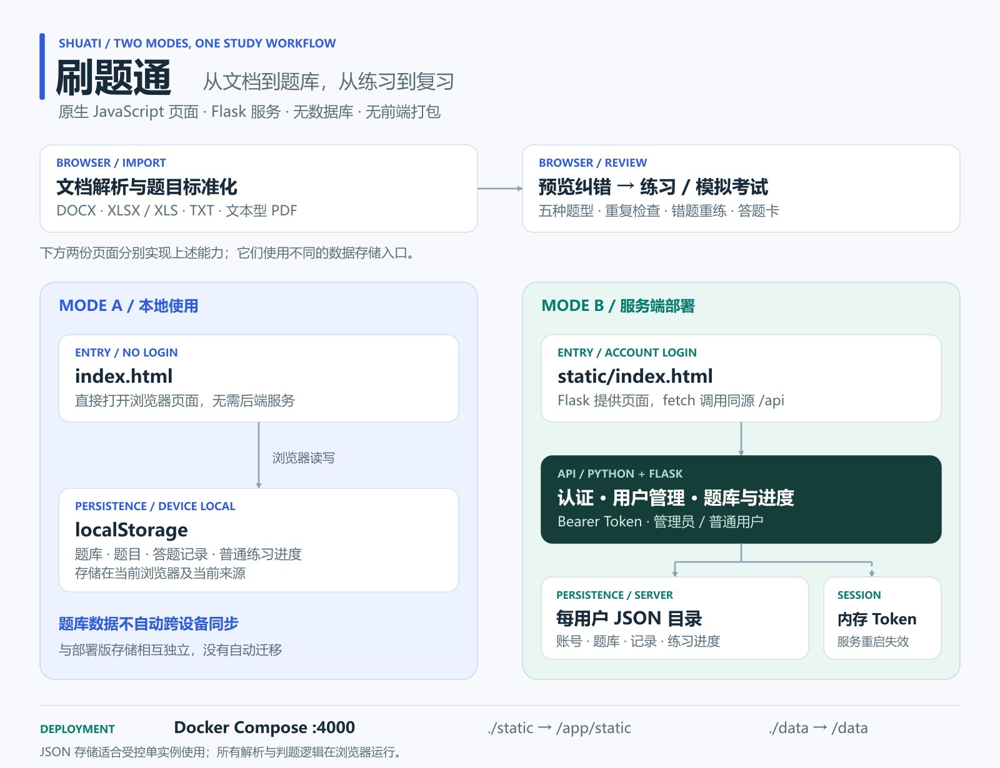

# Shuati · Question Practice and Review

[简体中文](README.md) | [English](README.en.md)

Turn existing exam papers into question banks, then practice, review mistakes, and take mock exams in one interface. It supports DOCX, Excel, TXT, text-based PDF, and five question types: single choice, multiple choice, true / false, fill in the blank, and short answer.

**For a first try, open the root `index.html` directly.** Start the Flask / Docker version when you need accounts and access across devices. The two modes store separate question banks and do not synchronize automatically.

[Five-question example](#complete-a-practice-round-with-the-five-question-example) · [Your papers](#prepare-your-own-paper) · [Accounts](#start-the-account-based-version) · [Backups](#storage-and-backups) · [Implementation](#how-documents-become-question-banks)

## Complete a practice round with the five-question example

Download and extract the full repository, or run:

```bash
git clone https://github.com/kayaduster607-jpg/shuati.git
cd shuati
```

1. Open the root `index.html` in a browser, enter “题库管理” (question-bank management), and create a bank named “入门演示”.
2. Choose “上传文档导入” (import document) in that bank and upload [examples/questions.txt](examples/questions.txt). It already contains all five question types.
3. Check each preview's statement, options, answer, and explanation. Resolve warnings and confirm adding the questions. **A preview is not saved until you confirm.**
4. Start practicing and choose A (Python) for the first question to see feedback and the explanation. Intentionally miss another question, then retry it from the mistake collection.
5. Leave normal practice and reopen it to check resume progress. For a full test, set question counts and points per question in mock-exam mode, generate the exam, and submit it to view your score.

Inputs are question files and your answers. Outputs are a usable question bank, answer feedback, mistakes, and exam scores; normally no file is downloaded. Local mode stores data in the current browser and needs network access to load document-parsing libraries.

## Prepare your own paper

For TXT / DOCX body text, use this layout:

```text
一、单选题
1. 以下哪种语言用于编写 Flask 应用？
A. Python
B. CSS
C. SQL
D. HTML
答案：A
解析：Flask 是 Python Web 框架。

二、多选题
2. 以下哪些属于浏览器端技术？
A. HTML
B. CSS
C. JavaScript
D. SQLAlchemy
答案：A,B,C
```

For Excel, use columns `题型、题目、A、B、C、D、答案、解析` (type, question, options, answer, explanation). Save legacy `.doc` as `.docx` first. Scanned PDFs require another tool to OCR them into extractable text first.

Import checks missing answers, insufficient options, unusual statements, and potential duplicates. Parsing is rule-based, making preview essential. Fill-in and short answers use cleaned-string comparison without semantic grading. Multiple-choice answers require the exact option combination; there is no partial credit.

## Start the account-based version

### Docker Compose

Run from the project root:

```bash
docker compose up -d --build
docker compose logs -f shuati
```

Open [http://localhost:4000](http://localhost:4000). On first startup with an empty user list, these **public demo accounts** are created:

| Username | Initial password | Purpose |
| --- | --- | --- |
| `admin` | `admin123` | Create users, reset passwords, and view statistics |
| `user` / `user2` / `user3` | `123456` | Personal question banks and practice |

After signing in, follow the five-question workflow above. Before letting others access the service, change retained account passwords and delete unused demo users. Open self-registration is not available.

### Without Docker

In Windows PowerShell, run the following; use your platform's virtual-environment Python elsewhere:

```powershell
py -3.11 -m venv .venv
.\.venv\Scripts\python.exe -m pip install Flask Flask-Cors
$env:DATA_DIR = Join-Path (Get-Location) "data"
.\.venv\Scripts\python.exe app.py
```

The port remains 4000. Explicit DATA_DIR avoids the default absolute `/data` directory. The application reads process environment variables directly.

## Storage and backups

| Mode | Location | After restart / device change |
| --- | --- | --- |
| Root HTML | Question banks, questions, records, and resume progress in localStorage | Continue with the same browser origin; clearing browser data loses them |
| Flask / Docker | JSON under DATA_DIR, separated into user directories | The same account on the same server reads saved data; sign in again after restart |

The deployed version stores accounts in `data/users.json`; `data/userdata/<user_id>/` contains `banks.json`, `questions.json`, `records.json`, and `saved_practice.json`. Compose mounts all of `./data` and `./static`. Stop writes before backing up the complete `data/` directory, not only the account file.

Normal practice supports resuming. Mock exams lack the same resume snapshot, so do not rely on refresh to restore an exam. Deleting a bank deletes its questions but does not cascade-clean old answer records.

## How documents become question banks



File parsing, candidate validation, question rendering, grading, and score calculation run in the browser. The deployed version sends only confirmed structured questions and practice records to Flask, which chooses a JSON directory by signed-in user. Pages live separately in `index.html` and `static/index.html`; check both when changing shared behavior.

Personal use needs no database, but the design limits server capabilities: whole-file JSON has no file locking, in-memory tokens have no expiry, and passwords use unsalted SHA-256. Use locally or in a controlled single instance. Answers are sent to the browser, so scores support self-study, not formal exam anti-cheating guarantees.

## Troubleshooting and development

| Issue | First check |
| --- | --- |
| No questions after import | Confirm adding questions and resolve warnings such as missing answers |
| Empty PDF preview | Check whether it is a scan; there is no OCR |
| Local bank absent in account mode | Storage is separate, with no automatic migration |
| Container API works but page does not | A standalone docker run may omit the static mount; prefer Compose |
| Equivalent short answer is marked wrong | Matching is string-based; check the reference answer or adjust manually |

```bash
python scripts/verify_api.py
node scripts/verify_frontend.cjs
```

See [docs/validation.md](docs/validation.md) for verification scope. Core API routes in `app.py` include `/api/auth/*`, `/api/banks`, `/api/questions`, `/api/records`, and `/api/saved-practice`. Business requests use the Bearer token returned by login. The diagram also has an [SVG source](docs/assets/architecture.svg).

There is no standalone LICENSE in the repository; confirm permission before reuse or redistribution.
