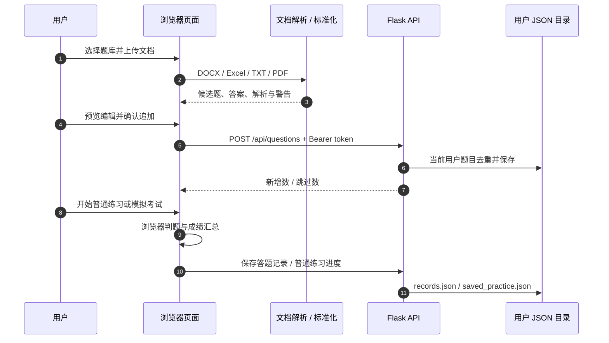

<div align="center">

# 刷题通 · Shuati

**把文档变成可练习的题库，让刷题、错题复习和模拟考试连成一条流程。**

Word / Excel / TXT / PDF 导入 · 五种题型 · 本地与服务端双模式


[项目亮点](#项目亮点) · [系统架构](#系统架构) · [快速开始](#快速开始) · [导入题库](#导入题库) · [部署与备份](#部署与备份) · [验证记录](docs/validation.md)

</div>


刷题通是一个轻量的在线练习平台：把已有文档解析成结构化题目，在导入前修正题干、答案与重复项，再进行日常练习、错题重练或按题型组卷的模拟考试。适合个人备考、课程复习和受控小团队的题库管理。

项目提供两个独立入口：**根目录 `index.html` 是无需后端的本地版，`app.py` + `static/index.html` 是带账号和服务端存储的部署版**。页面使用原生 JavaScript，无前端打包步骤；部署版只需一个 Flask 服务及 JSON 文件存储，不依赖数据库。

## 先用一次：导入自己的题库，再完成练习

| 输入 | 在哪里输入 | 输出与保存位置 |
| --- | --- | --- |
| 带题号、选项和答案的试题文件 | “题库管理”中的“上传文档导入” | 导入预览；确认后才形成题库 |
| 单选/多选答案、判断或填写内容 | 题库的练习页面 | 对错、标准答案、解析和答题记录 |
| 练习范围与模式 | 选择顺序、随机、错题或考试入口 | 对应练习进度；考试结束后的成绩与错题 |

### 无需服务器的第一次操作

1. 下载仓库后，用浏览器打开根目录 `index.html`。这个版本不需要登录，但文档解析库通过CDN加载，需要联网。
2. 点击“题库管理” → “新建题库”，名称输入“入门演示”。
3. 打开刚建的题库，点击“上传文档导入”，选择[examples/questions.txt](examples/questions.txt)。它包含单选、多选、判断、填空和简答共五题，格式可直接照抄。
4. 在预览中检查题目、选项、答案和解析，修正识别问题后确认导入。未经确认的预览不会直接写进题库。
5. 进入练习，回答第一题。示例第一题选择A（Python），即可核对反馈；再试一次错误答案，观察错题入口。

**保存位置：**本地版把题库和记录放在当前浏览器的localStorage，没有自动生成下载文件，也不会自动同步到另一台电脑。Docker/Flask版则保存到服务器DATA_DIR，必须登录对应账号；两个版本的数据不会自动互相导入。

**换成自己的试卷：**优先按五题示例的“题号、A/B/C/D选项、答案、解析”格式整理；也支持DOCX、Excel、TXT和文本型PDF。扫描PDF不能依靠当前解析器自动OCR。先核对预览，再开始刷题。

## 项目亮点

| 能力 | 具体实现 |
| --- | --- |
| 多格式文档导入 | 支持 `.docx`、`.xlsx`、`.xls`、`.txt` 和文本型 `.pdf`；Word 同时尝试表格/正文与纯文本提取，Excel 遍历工作表并映射表头 |
| 导入前预览与纠错 | 检查题干过短、缺少答案、选择题选项不足、重复题目；允许编辑、移除候选题，再选择全部新增或无警告新增题目 |
| 五类题目统一管理 | 单选、多选、判断、填空、简答；题库内可按题型筛选、关键词搜索、编辑与删除 |
| 日常练习与续练 | 支持顺序/随机出题、题型筛选、即时/结束后反馈；普通练习保存进度，可继续未完成的练习 |
| 错题重练 | 根据历史错误记录筛出相关题目，再次练习；并非“最近一次答对就移出”的独立错题状态机 |
| 可配置模拟考试 | 按题型设置抽题数量与每题分值，提供答题卡、题间跳转、正向计时和交卷后的分项成绩 |
| 部署版账号管理 | 管理员创建/删除用户、重置密码和查看用户数据统计；普通用户可修改密码，题库和记录按用户目录隔离 |
| 低运维成本 | 本地版保存在浏览器；部署版用一个容器及挂载目录保存数据，备份不需要数据库工具 |

## 两种使用模式

| 项目 | 本地版 | 部署版 |
| --- | --- | --- |
| 入口 | 根目录 `index.html` | 启动 Flask 后访问 `/`，实际页面为 `static/index.html` |
| 账号 | 无需登录 | 管理员/普通用户，管理员创建账号 |
| 题库与答题记录 | 当前浏览器 localStorage | 服务端 `DATA_DIR` 下的 JSON 文件 |
| 多设备 | 不会自动同步 | 同一账号访问同一服务，可读取服务端已保存内容 |
| 依赖 | 浏览器及解析库 CDN | Python + Flask + Flask-Cors，或 Docker Compose |
| 数据迁移 | 与部署版相互独立 | 不会自动导入本地版 localStorage |

两份页面独立维护，字段命名和部分实现存在差异：本地题目使用 `bankId`、`sourceFile`，部署版使用 `bank_id`、`source_file`。修改共有功能时应检查两份页面。

## 系统架构

架构图提供 [PNG](docs/assets/architecture.png)、[SVG 矢量原稿](docs/assets/architecture.svg) 和 [绘图脚本](docs/assets/generate_architecture.py)。

| 模块 | 职责 | 实现 |
| --- | --- | --- |
| 文件解析 | 在浏览器读取文档、提取正文/表格并识别题目 | Mammoth.js 1.8.0、SheetJS 0.18.5、PDF.js 3.11.174、原生 File API |
| 题目标准化 | 识别题型，拆分选项、答案和解析，生成校验与重复警告 | 页面内 JavaScript 规则 |
| 练习与考试 | 筛题、抽题、计时、答题卡、答案比较和结果展示 | 原生 JavaScript + HTML/CSS |
| 本地数据层 | 读写题库、题目、答题记录及续练进度 | localStorage |
| 服务端 API | 登录、角色检查、用户管理、题库 CRUD 与进度保存 | Flask、Flask-Cors |
| 服务端存储 | 用户账号及按账号目录分开的业务数据 | Python JSON 文件读写 |
| 部署 | 暴露 4000 端口，挂载数据与页面目录 | Docker、Compose |

原始文档由浏览器解析，部署版随后将结构化题目及来源文件名提交给后端。后端保存题目和练习数据，不承担文档解析或判题计算。



## 快速开始

### 方式一：直接使用本地版

```bash
git clone https://github.com/kayaduster607-jpg/shuati.git
cd shuati
```

用浏览器打开根目录 `index.html`，进入“题库管理”新建题库，导入 [五题示例](examples/questions.txt)，即可开始练习。

文件解析库通过 CDN 加载，需要联网。localStorage 数据跟随浏览器和来源保存，清理浏览器数据可能丢失题库；更换浏览器、文件位置或访问来源时，不应假定数据会自动迁移。

### 方式二：Docker Compose 部署版

需要 Docker Engine 和 Compose。从仓库根目录运行：

```bash
docker compose up -d --build
docker compose logs -f shuati
```

访问 [http://localhost:4000](http://localhost:4000)。Compose 将 `./data` 挂载为容器的 `/data`，将 `./static` 挂载为 `/app/static`。首次启动且用户列表为空时，创建下列演示账号：

| 用户名 | 初始密码 | 角色 |
| --- | --- | --- |
| `admin` | `admin123` | 管理员 |
| `user` | `123456` | 普通用户 |
| `user2` | `123456` | 普通用户 |
| `user3` | `123456` | 普通用户 |

**这些是源码中公开的演示凭据。部署后应修改所有保留账号的密码，或删除不需要的演示用户，再允许其他人访问。** 管理员管理用户，普通用户从“个人中心”修改密码；没有公开自助注册流程。

### 方式三：直接运行 Flask

推荐 Python 3.11，与 Docker 基础镜像一致。Windows PowerShell：

```powershell
py -3.11 -m venv .venv
.\.venv\Scripts\python.exe -m pip install Flask Flask-Cors
$env:DATA_DIR = Join-Path (Get-Location) "data"
.\.venv\Scripts\python.exe app.py
```

macOS / Linux：

```bash
python3.11 -m venv .venv
.venv/bin/python -m pip install Flask Flask-Cors
export DATA_DIR="$PWD/data"
.venv/bin/python app.py
```

启动后同样访问 [http://localhost:4000](http://localhost:4000)。直接运行时请显式设置 `DATA_DIR`，避免使用默认绝对目录 `/data`。本项目不自动加载 `.env`；该配置通过进程环境变量读取。

## 导入题库

先新建题库，再上传文件。推荐使用固定的题号、选项标记和答案/解析标签；系统支持预览修正，识别结果仍需人工检查。

```text
一、单选题
1. 以下哪种语言用于编写 Flask 应用？
A. Python
B. CSS
C. SQL
D. HTML
答案：A
解析：Flask 是 Python Web 框架。

二、多选题
2. 以下哪些属于浏览器端技术？
A. HTML
B. CSS
C. JavaScript
D. SQLAlchemy
答案：A,B,C
```

Excel 推荐表头为 `题型`、`题目`、`A`、`B`、`C`、`D`、`答案`、`解析`；代码也识别部分常见中文或英文别名。旧版 Word `.doc` 不受支持，应先转换为 `.docx`；PDF 仅提取文字层，没有 OCR，扫描图片题库需先转为可提取文本的文档。

填空与简答使用清理部分标点、空白并转小写后的**字符串相等比较**，不进行语义评分。多选按标准化后的选项组合比较，漏选不会按部分正确给分。考试计时器显示已用时间，不是带强制交卷的倒计时。

## 数据存储

本地版的四个键为 `shuati_banks`、`shuati_questions`、`shuati_records`、`shuati_saved_practice`。部署版 localStorage 保存登录信息 `shuati_token` / `shuati_user`，题库与记录由 API 获取。

```text
data/                         # Compose 挂载目录；不提交到仓库
├── users.json                # 账号、角色、密码哈希
└── userdata/
    └── <user_id>/
        ├── banks.json        # 题库
        ├── questions.json    # 题目与答案
        ├── records.json      # 答题记录
        └── saved_practice.json  # 普通练习进度
```

后端根据当前登录用户选择目录。删除题库会删除所属题目；旧答题记录没有同步级联清理。普通练习会保存续练进度，考试模式不保存这份续练快照，正在进行的考试不要依赖刷新恢复。

## 部署与备份

```bash
# 查看状态与日志
docker compose ps
docker compose logs --tail 100 shuati

# 停止 / 再次启动，data 目录保持在宿主机
docker compose stop
docker compose start
```

备份应在暂停写入后保存整个 `data/`，包含账号、题库和记录。Linux/macOS 示例：

```bash
docker compose stop
tar -czf shuati-data-backup.tar.gz data
docker compose start
```

备份包含用户信息和题目，应私下保存，不上传公开仓库。修改宿主机端口时，将 Compose 的 `4000:4000` 改为例如 `8080:4000`，执行 `docker compose up -d` 后使用新端口访问。

`Dockerfile` 只复制后端代码，页面依赖 Compose 的 `./static:/app/static` 挂载；单独 `docker run` 时还需自行挂载页面和数据目录。`deploy.sh` 使用旧式 `docker-compose` 命令，安装了独立 Compose 时可用；本文优先使用 `docker compose`。

当前使用 Flask 开发服务器、内存 Token 和无文件锁的整份 JSON 读写，适合本地或受控单实例使用。服务重启后需重新登录；Token 没有到期时间，改密不会撤销已有 Token；页面退出仅清除本地登录信息，后端另有 `/api/auth/logout` 注销接口。密码采用无盐 SHA-256。若需对公网提供多人服务，应先完善密码存储、会话撤销、限流、HTTPS、生产 WSGI 服务及支持并发的数据存储。

题目答案会下发到浏览器，成绩在前端计算，因此模拟考试用于自测练习，不提供防作弊或正式考试成绩可信性保证。

## API 概览

部署版业务请求使用 `Authorization: Bearer <token>`，由登录接口返回 Token。以下接口均已在代码中实现：

| 模块 | 接口 | 说明 |
| --- | --- | --- |
| 登录 | `POST /api/auth/login` · `GET /api/auth/me` | 登录、读取当前身份 |
| 账号 | `POST /api/auth/change-password` · `POST /api/auth/logout` | 改密、注销 Token |
| 用户管理 | `GET/POST /api/admin/users` · `DELETE /api/admin/users/<id>` | 管理员查看、创建、删除用户 |
| 管理操作 | `POST /api/admin/users/<id>/reset-password` · `GET /api/admin/stats` | 重置密码、查看统计 |
| 题库 | `GET/POST /api/banks` · `DELETE /api/banks/<id>` | 列表、创建、删除 |
| 题目 | `GET/POST /api/questions` · `PUT/DELETE /api/questions/<id>` | 筛选、批量追加、编辑、删除 |
| 记录 | `GET/POST /api/records` | 查询、追加答题记录 |
| 进度 | `GET/PUT/DELETE /api/saved-practice` | 读取、保存、清除普通练习进度 |

## 开发与验证

没有前端依赖安装或打包步骤；第三方解析库直接由 HTML 引入。API 验证使用临时目录和 Flask 测试客户端；前端验证在 Node.js VM 中检查内联脚本语法、五题示例解析、Excel 列映射、去重及答案比较，不读取浏览器数据。

安装 Flask/Flask-Cors 后，从根目录运行：

```bash
python scripts/verify_api.py
node scripts/verify_frontend.cjs
```

本次结果为 **27 项 API 检查 + 32 项前端逻辑检查通过**。具体环境、Docker 检查及未验证范围见 [验证记录](docs/validation.md)。Node.js 仅用于该验证脚本，不是应用运行依赖。

## 项目结构

```text
shuati/
├── index.html                # 本地版：浏览器存储
├── app.py                    # Flask API、认证及 JSON 持久化
├── static/index.html         # 部署版：账号与 API 数据访问
├── Dockerfile
├── docker-compose.yml        # 4000 端口、data/static 挂载
├── deploy.sh                 # 兼容旧式 docker-compose 的启动脚本
├── examples/questions.txt    # 五种题型的可导入示例
├── scripts/                  # 可复现的发布验证
├── docs/assets/              # 架构图与生成脚本
└── data/                     # 首次运行时生成，Git 忽略
```

## 后续方向

可继续完善两份页面的公共逻辑复用、题库导入/导出备份、依赖版本固定、账号安全、并发存储和自动化 UI 测试。这些方向不作为当前已实现功能。

项目当前没有独立 `LICENSE` 文件；公开可见不代表已授予特定开源许可证，使用或再分发前请与维护者确认。
